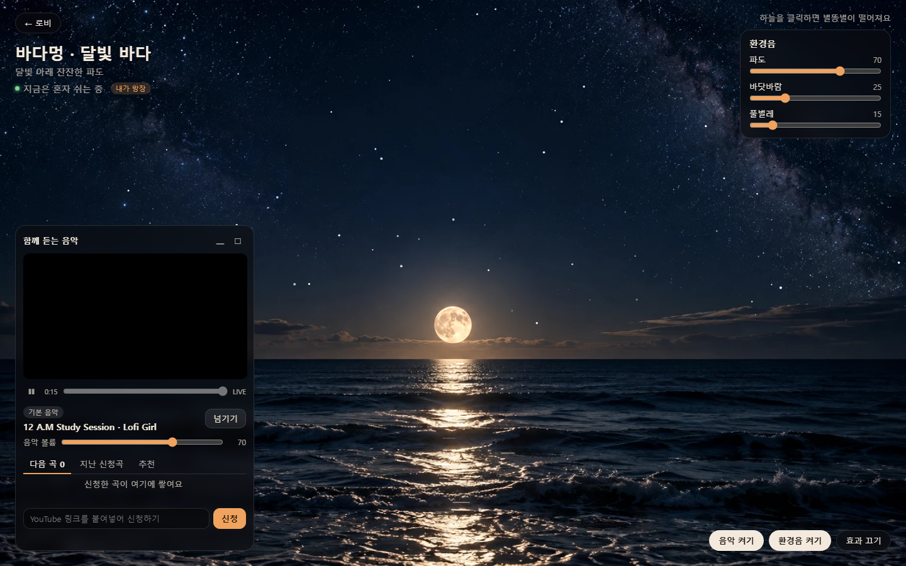
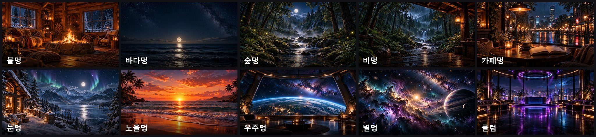
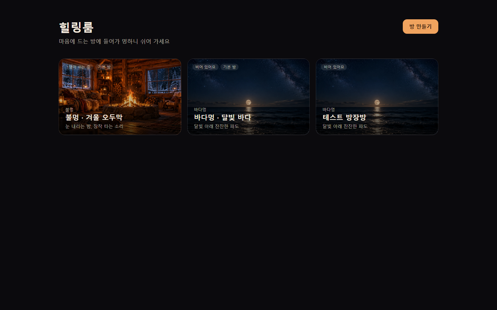

<p align="center"></p>

# 🔥 힐링룸 (Healing Room)

> 화면을 켜두고 멍하니 쉬는 웹 공간. 모닥불, 밤바다, 비 오는 숲, 우주를 바라보며 같은 방 사람들과 같은 음악을 들어요.

<p align="center">
  <a href="https://healing.kimseongmin.co.kr"><b>👉 지금 바로 들어가기 · healing.kimseongmin.co.kr</b></a>
</p>



**로그인도, 설치도 없어요.** 주소를 열고 마음에 드는 방에 들어가면 끝이에요.

- 🔥 **살아 움직이는 배경 10가지**: 불멍, 바다멍, 숲멍, 비멍, 카페멍, 눈멍, 노을멍, 우주멍, 별멍, 클럽. 실사 배경 위에서 불꽃, 눈, 빗방울, 반딧불, 오로라가 움직이고, 화면을 누르면 반응해요.
- 🎧 **함께 듣는 음악**: 같은 방 사람들은 YouTube 음악을 **같은 곡, 같은 위치**로 들어요. 라디오처럼요. 노래를 검색해서 신청하고, 신청곡이 없으면 비슷한 곡이 이어서 나와요.
- 🌧️ **환경음**: 장작, 빗소리, 파도, 시냇물, 풀벌레, 우주의 화음까지 녹음 파일 없이 브라우저에서 만들어요.
- 💬 **채팅**: "졸린 고양이", "포근한 달빛" 같은 닉네임이 자동으로 붙어요.
- 🏠 **누구나 방 만들기**: 테마를 골라 내 방을 만들고 주소를 친구에게 보내면 함께 쉴 수 있어요.



> 🌙 일하면서, 공부하면서, 잠들기 전에 켜 두세요. 👉 **https://healing.kimseongmin.co.kr**



---

## 목차

1. [기능](#-기능)
2. [사용 방법](#-사용-방법)
3. [같은 위치로 듣는 원리](#-같은-위치로-듣는-원리)
4. [기술 스택](#-기술-스택)
5. [설치와 실행](#-설치와-실행)
6. [프로젝트 구조](#-프로젝트-구조)
7. [API](#-api)
8. [테마 추가하기](#-테마-추가하기)
9. [문제 해결](#-문제-해결)
10. [AI 도구로 작업하기](#-ai-도구로-작업하기)
11. [로드맵](#-로드맵)

---

## ✨ 기능

### 테마와 방
| | |
|---|---|
| **테마** | 배경, 시각 효과, 환경음, 기본 음악의 묶음이에요. 지금은 10가지가 있어요: 🔥 불멍 · 🌊 바다멍 · 🌲 숲멍 · 🌧️ 비멍 · ☕ 카페멍 · ❄️ 눈멍 · 🌅 노을멍 · 🪐 우주멍 · 🌌 별멍 · 🪩 클럽 |
| **기본 방** | 항상 열려 있는 방이에요. 지금은 불멍, 바다멍 두 개이고, 나머지 테마는 방을 만들 때 골라요. |
| **방 만들기** | 로비에서 이름과 테마를 골라 누구나 방을 만들 수 있어요. 한 사람이 동시에 3개까지 열 수 있어요. |
| **빈 방 닫기** | 아무도 없는 채로 **30분**이 지나면 방이 닫혀요. 그 전에 누가 들어오면 시간이 처음부터 다시 셉니다. |
| **방장** | 방에 가장 먼저 들어온 사람이에요(보통 만든 사람). 방장이 나가면 그다음에 들어온 사람이 이어받아요. 새로고침처럼 20초 안에 돌아오면 자리를 지켜줘요. |

### 살아 움직이는 배경
- **불멍**: 불꽃이 일렁이고, 방 안 불빛과 랜턴이 깜빡이고, 불씨가 피어오르고, 창밖에 눈이 내려요. **화면을 클릭하면 장작이 들어가요.**
- **바다멍**: 물결이 출렁이고, 달빛이 반짝이고, 별이 깜빡여요. **하늘을 클릭하면 별똥별이 떨어져요.**
- **숲멍**: 시냇물이 흐르고, 반딧불이 떠다니고, 안개가 낮게 흘러요. **클릭하면 반딧불이 날아올라요.**
- **비멍**: 비가 내리고, 시냇물과 폭포가 흐르고, 젖은 바닥에 빗방울이 퍼지고, 처마 랜턴이 깜빡여요. **하늘을 클릭하면 번개가 쳐요.**
- **카페멍**: 유리창에 맺힌 빗방울이 흘러내리고, 커피에서 김이 올라와요. **창문을 클릭하면 빗방울이 흘러요.**
- **눈멍**: 눈이 내리고, 오로라가 일렁이고, 달빛이 언 호수에서 반짝이고, 창문과 랜턴이 깜빡여요. **클릭하면 바람이 불어요.**
- **노을멍**: 파도가 밀려오고, 노을빛이 물 위에서 반짝이고, 갈매기가 지나가요. **하늘을 클릭하면 갈매기가 날아가요.**
- **우주멍**: 전망대 창밖으로 별이 반짝이고, 행성 대기가 빛나고, 밤 지역 도시 불빛이 깜빡여요. **하늘을 클릭하면 별똥별이 떨어져요.**
- **별멍**: 성운 사이 밝은 별이 숨 쉬듯 빛나고, 별가루가 천천히 돌아요. **클릭하면 별똥별이 떨어져요.**
- **클럽**: 조명이 박자(분당 100박)에 맞춰 밝아지고, 색이 바뀌고, 빛줄기가 흔들려요. **클릭하면 조명이 번쩍여요.**

### 함께 듣는 음악 (YouTube)
- 누구나 YouTube 링크를 붙여넣거나 **노래 제목·가수로 검색**해서 곡을 **신청**할 수 있어요(개수 제한 없음). 검색은 YouTube 하루 사용량을 자동 추천과 함께 쓰므로 한 사람이 1분에 5번까지예요.
- 입력칸에 **링크가 아닌 말**(예: `아이유 밤편지`)을 넣으면 **검색** 탭에 결과가 썸네일, 채널, 길이와 함께 나와요. 이 사이트에서 재생할 수 있는 영상만 보여줘요.
- 신청곡이 없으면 **방금 나온 곡과 비슷한 영상이 자동으로 이어져요(자동 추천)**. 같은 노래의 다른 영상(공식 MV, 라이브, 가사 영상)은 다시 고르지 않아요. 추천을 못 찾으면 테마 기본 음악이 나와요. 자동으로 나온 곡은 **누구나 바로 넘길 수 있고**, 누가 곡을 신청하면 바로 신청곡으로 바뀌어요.
- 모두 같은 위치를 들어야 하므로 **영상은 직접 조작할 수 없어요.** 볼륨만 각자 조절해요. 자막은 꺼져 있어요. ([원리](#-같은-위치로-듣는-원리))
- **넘기기와 빼기**

  | 누가 | 무엇을 | 어떻게 |
  |---|---|---|
  | 누구나 | 기본 음악, 자동 추천 곡 | 바로 |
  | 신청한 사람 | 내 신청곡 | 바로 |
  | 방장 | 아무 곡이나 | 바로 |
  | 그 밖의 사람 | 다른 사람의 신청곡 | 방 인원의 **과반(50% 초과)**이 투표하면 |

  필요한 표 수는 1명일 때 1표, 2명일 때 2표, 3명일 때 2표, 4명일 때 3표예요. 방을 나간 사람의 표는 세지 않아요.
- **방장만 할 수 있는 것**: 모두의 재생 멈추기와 이어서 재생, 재생 위치 옮기기, 대기열 순서 바꾸기(▲▼)
- **목록**: 다음 곡, 지난 신청곡(최근 30곡), 추천, 검색
- **추천**
  - 내가 자주 신청한 곡: 이 브라우저에 저장된 내 신청 기록
  - 비슷한 영상: 지금 곡과 비슷한 YouTube 음악 영상. [API 키](#3-환경변수-설정)가 있을 때만 나와요
  - 이 곡과 함께 신청된 곡: 같은 방에서 비슷한 시간대에 함께 신청된 곡
  - 이 테마 인기곡: 같은 테마 방들에서 최근 30일 동안 많이 신청된 곡
- 재생할 수 없는 영상(삭제됨, 외부 재생 금지)이면 자동으로 넘기기에 한 표를 넣어요.
- 음악 창은 **기본, 최소화, 최대화** 세 가지 크기로 바꿀 수 있어요.

### 기록 초기화
- 장난으로 이상한 영상이 올라왔을 때 쓰는 기능이에요. 지난 신청곡, 투표, 인기곡 통계, 채팅을 지우고 기본 음악부터 다시 틀어요.
- **기본 방(불멍, 바다멍)의 방장**에게만 방 이름 아래 **"🧹 기록 초기화"** 버튼이 보여요.
- 관리자 화면(`/admin.html`)에서는 방별 또는 **모든 방**을 한 번에 초기화할 수 있어요.

### 함께 있는 사람
- 방 이름 아래 **"👥 함께 있는 사람"** 버튼을 누르면 지금 방에 있는 사람 목록이 펼쳐져요. 닉네임, 방장(👑), 들어온 지 얼마나 됐는지가 보여요.
- IP는 **앞부분만**(`203.0.*.*`) 보여요. 같은 사람인지 정도만 구분되게 하고, 전체 IP는 관리자만 볼 수 있어요.
- **관리자 화면** `/admin.html`: `.env`의 `ADMIN_TOKEN` 키를 넣으면 모든 방의 접속자와 전체 IP를 볼 수 있어요. 키를 비워 두면 이 기능은 꺼져요.

### 채팅
- 방마다 채팅 창이 있어요. 늦게 들어와도 **최근 대화 100개**를 볼 수 있어요.
- 닉네임은 형용사 10개 × 명사 10개 중에서 무작위로 골라 "졸린 고양이", "따뜻한 장작"처럼 자동으로 붙어요. ✎를 눌러 12자까지 바꿀 수 있고, 이 브라우저에 저장돼요.
- 대화 보관: 사용자가 만든 방은 **방이 닫힐 때 함께 지워지고**, 기본 방은 **최근 24시간** 대화만 보여요.
- 도배 방지: 한 사람이 10초에 6개까지 보낼 수 있어요.
- 채팅 창은 접을 수 있고, 접어 둔 동안 온 메시지 수를 보여줘요.

### 환경음
- 장작, 바람, 비, 파도, 풀벌레, 시냇물, 천둥, 도시, 갈매기, 우주정거장 소리, 우주의 화음, 라운지 비트를 **녹음 파일 없이 브라우저에서 합성**해요. 테마마다 어울리는 소리가 나오고, 슬라이더로 섞을 수 있어요.
- **음악과 환경음은 따로 켜고 꺼요.** 음악이 나오는 동안에는 환경음이 자동으로 쉬었다가, 음악이 멈추면 다시 나와요. 직접 누른 설정이 항상 우선이에요.

---

## 🎧 사용 방법

1. **로비**에서 방 카드를 누르거나, 오른쪽 위 **방 만들기**에서 이름과 테마를 골라 새 방을 만들어요.
2. 방에 들어가면 음악과 환경음이 나와요. 주소로 바로 들어왔다면 브라우저 정책 때문에 오른쪽 아래 **음악 켜기**, **환경음 켜기**를 직접 눌러야 해요.
3. 음악 창 아래 입력칸에 **노래 제목을 입력하거나 YouTube 링크를 붙여넣고 신청**해요. 제목이면 **검색** 탭에 결과가 나오고, 눌러서 신청해요. **추천** 탭에서 한 번에 신청할 수도 있어요.
4. 방장이라면 이름 옆에 **"내가 방장"**이 보이고, 재생 위치 바와 ❚❚ 버튼으로 모두의 재생을 조작할 수 있어요.
5. 오른쪽 아래 **채팅** 창에서 같은 방 사람들과 이야기해요.

> 방 주소를 친구에게 보내면 같은 방에 들어올 수 있어요. 예: `https://healing.kimseongmin.co.kr/#ab3k9xqz`

---

## ⏱ 같은 위치로 듣는 원리

영상을 서로 주고받지 않아요. 모두가 **"이 곡이 몇 시에 시작했는지"** 시각 하나만 공유해요.

1. 곡이 시작되면 서버가 **시작 시각**(`started_at`)을 기록해요.
2. 각자 브라우저가 **지금 위치 = 현재 시각 − 시작 시각** 을 계산해서 그 위치부터 틀어요. 늦게 들어와도 같은 곳을 들어요.
3. 컴퓨터마다 시계가 조금씩 달라서, 서버가 보내 준 서버 시각으로 **시계 차이를 보정**해요.
4. **5초마다** 내 위치와 들어야 할 위치를 비교해서 **3초 넘게** 어긋나면 다시 맞춰요(버퍼링, 느린 인터넷 대비).
5. 방장이 멈추면 멈춘 시각을 기록하고, 이어서 틀면 멈춰 있던 시간만큼 시작 시각을 뒤로 미뤄요. 바뀐 내용은 WebSocket으로 바로 전달돼요.

사람 사이 차이는 최대 3초 정도예요. 라이브 방송은 길이가 없어서 위치를 맞추지 않아요.

---

## 🛠 기술 스택

| 영역 | 기술 |
|---|---|
| Backend | Java 17 · Spring Boot 4.1 · Spring Data JPA · Spring WebSocket · Gradle |
| Database | PostgreSQL 16 · Redis 7 (채팅) |
| Frontend | HTML · CSS · JavaScript (ES Modules, 프레임워크 없음) · Canvas 2D · Web Audio |
| 외부 서비스 | YouTube IFrame Player API (재생, 키 불필요) · YouTube oEmbed (영상 확인, 키 불필요) · YouTube Data API v3 (검색·비슷한 영상·자동 추천, 키 필요) |

---

## 🚀 설치와 실행

### 1. 준비물
- **JDK 17**
- **PostgreSQL** 서버 (16에서 확인)
- **Redis** 서버 (7에서 확인) — 채팅에 써요

### 2. 코드 받기
```bash
git clone https://github.com/kimseongmin0301/healing_room.git
```

### 3. 환경변수 설정
`healing-room/.env.example`을 복사해 `healing-room/.env`를 만들고 값을 채워요. `.env`는 git에 올라가지 않아요.

```bash
cp healing_room/healing-room/.env.example healing_room/healing-room/.env
```

| 키 | 필수 | 설명 |
|---|---|---|
| `DB_HOST`, `DB_PORT`, `DB_NAME` | ✅ | PostgreSQL 주소, 포트, DB 이름(`healing_room`) |
| `DB_USERNAME`, `DB_PASSWORD` | ✅ | 앱이 사용할 계정 |
| `DB_ADMIN_USERNAME`, `DB_ADMIN_PASSWORD` | | DB를 처음 만들 때만 쓰는 관리자 계정이에요. 앱은 사용하지 않아요 |
| `YOUTUBE_API_KEY` | | 곡 검색, "비슷한 영상" 추천, 자동 추천에 써요. 비워 두면 검색이 꺼지고, 자동 추천은 함께 신청된 곡 → 기본 음악으로 대신해요 |
| `ADMIN_TOKEN` | | 관리자 화면(`/admin.html`) 키. 비워 두면 관리자 기능이 꺼져요. `openssl rand -hex 24` 같은 무작위 값을 써요 |
| `REDIS_HOST`, `REDIS_PORT` | ✅ | Redis 주소와 포트 |
| `REDIS_USERNAME`, `REDIS_PASSWORD` | ✅ | 이 앱 전용 Redis 계정 (아래 참고) |
| `REDIS_DATABASE` | | 사용할 Redis DB 번호 (기본 1) |

<details>
<summary><b>YouTube API 키 받는 법</b></summary>

1. [Google Cloud Console](https://console.cloud.google.com/)에서 프로젝트를 만들어요.
2. **API 및 서비스 → 라이브러리**에서 **YouTube Data API v3**를 사용 설정해요.
3. **사용자 인증 정보 → 사용자 인증 정보 만들기 → API 키**를 눌러요.
4. 키를 `.env`의 `YOUTUBE_API_KEY=` 뒤에 넣고 서버를 다시 시작해요.

무료 사용량은 하루 10,000이고 검색 한 번에 100을 써요(하루 약 100번). 곡 검색, 비슷한 영상, 자동 추천이 이 사용량을 함께 써요.
- 같은 검색어·같은 곡의 결과는 12시간 동안 다시 써서 사용량이 들지 않아요.
- 곡 검색은 한 사람이 1분에 5번까지예요.
- 다 쓰면 미국 서부 자정(한국 오후 4~5시)에 다시 채워지고, 그때까지 검색은 "링크로 신청해 주세요"라고 안내해요.
- 다른 사이트에서 재생할 수 있는 영상만 나오고, 재생이 막히기 쉬운 라이브 방송은 빠져요.
</details>

<details>
<summary><b>Redis 전용 계정 만드는 법</b> (다른 서비스와 Redis 를 같이 쓸 때)</summary>

이 앱은 `healing-room:`으로 시작하는 키와 채널만 쓰므로, 그것만 다룰 수 있는 계정을 만들어요. Redis 관리자 계정으로 접속해서 실행하세요.

```text
ACL SETUSER healing_room on >긴-무작위-비밀번호 resetkeys ~healing-room:* resetchannels &healing-room:* +@all -@dangerous
ACL SAVE
```

`ACL SAVE`는 ACL 파일(`aclfile`)을 쓰는 경우이고, 계정이 `redis.conf`에 있다면 `CONFIG REWRITE`를 써요. 재시작은 필요 없어요.
새 계정으로 `SET healing-room:test ok`는 되고 `FLUSHDB`는 `NOPERM`이 나오면 정상이에요.
</details>

### 4. DB 만들기 (처음 한 번)
관리자 계정으로 DB를 만들고 앱 계정을 소유자로 지정해요.

```sql
CREATE DATABASE healing_room OWNER <DB_USERNAME>;
```

그다음 **앱 계정으로** `healing-room/db/`의 SQL 파일을 **번호 순서대로(V1 → V7)** 실행해요.

```bash
cd healing_room/healing-room
for f in $(ls db/V*.sql | sort -V); do
  PGOPTIONS='-c lock_timeout=5s' psql -h <DB_HOST> -p <DB_PORT> -U <DB_USERNAME> -d healing_room -v ON_ERROR_STOP=1 -f "$f"
done
```

> ⚠️ **이 앱은 실행할 때 DB를 절대 자동으로 만들거나 바꾸지 않아요** (`ddl-auto=validate`).
> 테이블이 코드와 다르면 앱이 시작을 거부해요. 스키마를 바꿀 때는 `db/`에 새 SQL 파일(`V8__...sql`)을 추가해서 직접 실행하세요.
> `lock_timeout`은 다른 세션이 테이블을 잡고 있을 때 마이그레이션이 계속 기다리면서 서비스까지 멈추지 않게 하는 설정이에요.

### 5. 실행
```bash
cd healing_room/healing-room
./gradlew bootRun          # Windows: gradlew.bat bootRun
```

- 브라우저에서 http://localhost:18280 에 접속해요.
- 같은 네트워크의 다른 기기에서는 `http://{PC의 IP}:18280` 으로 들어와요.
- 포트를 바꾸려면 환경변수 `PORT`를 지정해요.
- `.env`를 읽으려면 **`healing-room/` 폴더에서 실행**해야 해요. IntelliJ에서는 실행 설정의 Working directory를 `healing-room`으로 맞춰요.

> 서버는 **한 대만** 띄워요. 음악 대기열 진행과 접속자 목록을 서버 메모리에서 관리하기 때문에, 같은 DB에 서버 두 대를 붙이면 곡이 두 번 넘어가는 식으로 꼬여요.

### 6. 테스트
```bash
cd healing_room/healing-room
./gradlew test
```
대부분의 테스트는 DB와 Redis 없이 돌아가요. `HealingRoomApplicationTests`만 실제 DB와 Redis에 접속해서 **코드와 테이블이 맞는지 확인**해요(읽기만 함). 그래서 `.env`가 있어야 하고, CI에서는 `./gradlew test -Pci`로 이 테스트만 빼고 돌려요.

---

### 7. 운영 서버 배포
`deploy/`에 systemd 서비스, nginx 설정, 스크립트가 있어요. 서버 경로·도메인·계정은 이 프로젝트 서버 기준이니, 다른 서버라면 파일 안의 값을 바꿔서 쓰세요.

| 파일 | 역할 |
|---|---|
| `install-root.sh` | **처음 한 번 (sudo)**: 서비스 등록, nginx 사이트 추가, HTTPS 인증서 발급. 여러 번 실행해도 안전하고, nginx 검사에 실패하면 되돌려요 |
| `deploy.sh` | **손으로 배포**: 테스트 → 빌드 → 업로드 → 재시작 → 확인. `rollback`으로 이전 버전으로 되돌리기 |
| `ci-receive.sh` | **자동 배포 받기** (서버): GitHub Actions 가 보낸 jar 를 저장하고 재시작, 실패하면 이전 버전으로 복구 |
| `healing-room.service` | systemd 서비스 정의 |
| `nginx-http.conf` / `nginx-https.conf` | 인증서 발급 전 / 후 nginx 설정 (WebSocket 포함) |

**자동 배포**: `main`에 푸시하면 GitHub Actions(`.github/workflows/deploy.yml`)가 테스트 → 빌드 → 서버 배포까지 해요. `healing-room/` 안의 파일이 바뀐 푸시만 배포하고, 문서만 바꾼 푸시는 배포하지 않아요. 진행 상황은 GitHub의 **Actions** 탭에서 볼 수 있어요.

- 배포 전용 SSH 키는 서버에서 `ci-receive.sh`만 실행할 수 있게 묶여 있어서, 키가 새어 나가도 서버에 접속할 수 없어요.
- 새 버전이 제대로 뜨지 않으면 **이전 버전으로 자동으로 되돌려요.**
- 필요한 Secrets: `DEPLOY_SSH_KEY`, `DEPLOY_KNOWN_HOSTS`, `DEPLOY_HOST`, `DEPLOY_PORT`, `DEPLOY_USER`

손으로 배포하려면:
```bash
bash deploy/deploy.sh
```

---

## 📁 프로젝트 구조

백엔드는 **도메인마다 controller / service / repository / entity / dto**를 두는 구조예요. 자세한 설명은 [AGENTS.md](AGENTS.md)에 있어요.

```
healing_room/
├─ README.md · AGENTS.md · CLAUDE.md
├─ deploy/                          운영 서버 배포 (systemd, nginx, 스크립트)
├─ docs/screenshots/                README 화면 캡처, 테마 모음
├─ docs/theme-image-prompts.md      새 테마 배경 이미지 요청서 (ChatGPT 에 첨부)
├─ design/                          디자인 시안(SVG·PNG)과 초기 프로토타입
└─ healing-room/                    Spring Boot 앱 (Gradle 프로젝트)
   ├─ .env.example                  환경변수 형식
   ├─ db/                           DB 스키마 SQL (직접 실행)
   └─ src/main/
      ├─ java/com/healingroom/
      │  ├─ domain/
      │  │  ├─ theme/               테마 (배경, 효과, 환경음, 기본 음악)
      │  │  ├─ room/                방 만들기, 목록, 빈 방 닫기
      │  │  ├─ queue/               함께 듣는 음악 (대기열, 투표, 방장 조작)
      │  │  ├─ chat/                방 채팅 (Redis)
      │  │  ├─ recommend/           곡 추천, 직접 검색
      │  │  ├─ admin/               관리자 (접속자 전체 IP, 기록 초기화)
      │  │  └─ presence/            방 접속자, 방장, 닉네임 (WebSocket)
      │  └─ global/                 공통 설정, 오류 응답
      └─ resources/static/          프론트엔드
         ├─ index.html · css/ · images/
         └─ js/
            ├─ app.js               화면 전환 (로비 ↔ 방)
            ├─ lobby.js             로비, 방 만들기
            ├─ music.js             YouTube 동기화, 대기열, 추천, 검색
            ├─ chat.js              채팅
            ├─ people.js            함께 있는 사람 목록
            ├─ admin.js             관리자 화면
            ├─ room-socket.js       실시간 연결
            ├─ scene.js             배경 캔버스
            ├─ audio/               환경음 합성과 믹서
            └─ effects/             테마별 시각 효과 (parts.js: 공통 조각)
```

---

## 🔌 API

로그인 대신 브라우저에 저장된 방문자 UUID를 `X-Visitor-Id` 헤더로 보내요. 곡 신청, 투표, 조작은 **그 방에 WebSocket으로 접속해 있을 때만** 할 수 있어요.
오류가 나면 `{ "message": "화면에 보여줄 문장" }`이 돌아와요.

| 메서드 | 경로 | 설명 |
|---|---|---|
| GET | `/api/themes` | 테마 목록 |
| GET | `/api/rooms` | 열려 있는 방 목록 (테마, 현재 인원 포함) |
| POST | `/api/rooms` | 방 만들기 `{ "name", "themeId" }` |
| GET | `/api/rooms/{id}` | 방 정보 + 환경음 목록 (닫힌 방은 404) |
| GET | `/api/rooms/{roomId}/queue` | 지금 곡, 대기열, 투표 현황, 내가 방장인지 |
| GET | `/api/rooms/{roomId}/queue/history` | 지난 신청곡 (최근 30곡) |
| POST | `/api/rooms/{roomId}/queue` | 곡 신청 `{ "url": "YouTube 링크" }` |
| PUT · DELETE | `/api/rooms/{roomId}/queue/{itemId}/vote` | 넘기기·빼기 / 투표 취소 |
| PUT | `/api/rooms/{roomId}/queue/{itemId}/duration` | 영상 길이 보고 (플레이어가 자동으로 호출) |
| PUT | `/api/rooms/{roomId}/queue/playback` | 방장: `pause` / `resume` / `seek` |
| PUT | `/api/rooms/{roomId}/queue/{itemId}/move` | 방장: 대기열 순서 `up` / `down` |
| GET | `/api/rooms/{roomId}/recommendations` | 곡 추천 |
| GET | `/api/rooms/{roomId}/search?q=` | 곡 검색 (방에 있는 사람만, 1분에 5번) |
| POST | `/api/rooms/{id}/reset` | 기본 방의 방장: 기록 초기화 |
| GET | `/api/admin/presence` | 관리자: 모든 방 접속자와 전체 IP (`X-Admin-Token` 필요) |
| POST | `/api/admin/reset?roomId=` | 관리자: 방별 또는 전체 기록 초기화 |
| GET | `/api/rooms/{roomId}/chat` | 지난 대화 (최근 100개) |
| POST | `/api/rooms/{roomId}/chat` | 채팅 보내기 `{ "nickname", "text" }` |
| WS | `/ws/rooms/{roomId}?visitorId=…&nickname=…` | 방 접속. 음악 상태, 새 채팅, 접속자 목록을 받아요 |

---

## ➕ 테마 추가하기

1. `healing-room/src/main/resources/static/images/`에 배경 이미지(16:9, 1672×941 webp 권장)를 넣어요. 이미지는 [요청서](docs/theme-image-prompts.md)를 ChatGPT 에 첨부해서 만들 수 있어요.
2. `healing-room/db/V{다음 번호}__add_{테마}.sql`을 만들어 아래 행을 추가하고 실행해요.
   - `theme`: 테마 정보 (이름, 제목, 설명, 배경 경로, 효과 이름)
   - `theme_ambient`: 환경음 (`fire`, `wind`, `rain`, `waves`, `crickets`, `stream`, `thunder`, `hum`, `pad`, `city`, `seagulls`, `beat` 중에서)
   - `theme_track`: 기본 음악
   - `room`: 기본 방이 필요하면 (`is_default = true`). 없어도 방 만들기에서 고를 수 있어요
3. `static/js/effects/{효과 이름}.js`를 만들어요. 별, 눈, 비, 반딧불, 김 같은 조각은 `effects/parts.js`에 있어요.

```js
export function create(scene) {
  return {
    draw(t) { /* 매 프레임 호출. 배경은 이미 그려져 있음 */ },
    click(u, v) { /* 클릭한 위치 (배경 기준 0~1 비율) */ },
  };
}
```

> 기본 음악은 **다른 사이트에서 재생(임베드)이 되는 영상**인지 꼭 확인하세요. 영상 정보가 조회되더라도 실제 플레이어에서는 막혀 있는 경우가 있어요(특히 라이브 방송).

---

## 🩺 문제 해결

| 증상 | 확인할 것 |
|---|---|
| 앱이 시작되지 않고 `Schema-validation` 오류가 나요 | `db/`의 SQL을 V7까지 모두 실행했는지 확인해요. |
| `Could not resolve placeholder 'DB_HOST'` | `.env`가 없거나, `healing-room/` 폴더가 아닌 곳에서 실행했어요. |
| `Port 18280 was already in use` | 이미 떠 있는 서버를 끄거나 `PORT=18281`처럼 다른 포트로 실행해요. |
| 소리가 안 나요 | 오른쪽 아래 **음악 켜기**, **환경음 켜기**를 눌러요. 브라우저는 사용자가 클릭하기 전에는 소리를 막아요. |
| "재생할 수 없는 영상이에요" | 업로더가 외부 재생을 막은 영상이에요. 다른 영상을 신청해요. |
| 추천에 "비슷한 영상"이 안 나와요 | `.env`에 `YOUTUBE_API_KEY`를 넣고 서버를 다시 시작해요. 하루 사용량을 다 썼을 수도 있어요. |
| 화면 파일을 고쳤는데 그대로예요 | `./gradlew bootRun`으로 띄웠다면 새로고침만 하면 돼요(`static/`을 src에서 바로 읽음). IntelliJ의 실행 버튼으로 띄웠다면 **빌드(Ctrl+F9)** 후 새로고침해요. 브라우저 캐시가 의심되면 Ctrl+Shift+R. |
| 다른 기기에서 접속이 안 돼요 | PC 방화벽에서 18280 포트를 허용했는지 확인해요. |
| "채팅 서버에 연결하지 못했어요" | Redis 주소·계정을 확인해요. `NOPERM`이 로그에 나오면 계정 권한(`~healing-room:*`, `&healing-room:*`)을 확인해요. 채팅만 안 되고 나머지는 동작해요. |
| "조금 천천히 보내 주세요" | 10초에 6개를 넘게 보냈어요. 잠깐 기다리면 다시 보낼 수 있어요. |
| "검색은 1분에 5번까지…" | 잠깐 기다렸다 다시 검색하거나 YouTube 링크로 신청해요. |
| "오늘 검색 횟수를 다 썼어요" | YouTube 하루 사용량을 다 썼어요. 한국 시간 오후 4~5시쯤 다시 채워져요. 그 전에는 링크로 신청해요. |
| 같은 노래가 계속 나와요 | "곡 - 가수"처럼 순서가 거꾸로 된 제목은 곡 이름을 정확히 못 뽑을 수 있어요. 자동으로 나온 곡은 누구나 바로 넘길 수 있어요. |

---

## 🤖 AI 도구로 작업하기

이 프로젝트는 AI와 함께 개발해요. 규칙과 맥락은 **[AGENTS.md](AGENTS.md)** 한 곳에 정리되어 있어요. DB 규칙, 패키지 구조, 프론트엔드 규칙이 들어 있어요.

| 도구 | 사용 방법 |
|---|---|
| Claude Code | `CLAUDE.md`가 `AGENTS.md`를 자동으로 불러와요 |
| Codex CLI | 저장소 루트의 `AGENTS.md`를 자동으로 읽어요 |
| ChatGPT (웹) | 대화를 시작할 때 `AGENTS.md`와 `README.md`를 첨부해요 |

---

## 🗺 로드맵

- [x] 불멍, 바다멍 테마 · 실사 배경 + 움직이는 효과
- [x] 로비 · 방 만들기 · 방장 · 빈 방 30분 뒤 닫기
- [x] 함께 듣는 YouTube 음악 (신청, 동기화, 과반 투표, 방장 조작, 지난 신청곡)
- [x] 곡 추천 (내 기록, 비슷한 영상, 함께 신청된 곡, 테마 인기곡)
- [x] 환경음 합성과 믹서, 음악 재생 중 자동 쉬기
- [x] 방 채팅 (Redis)
- [x] 접속자 목록 · 관리자 화면
- [x] 자동 추천 재생
- [x] 배경 영상 지원 (영상 파일은 준비 중)
- [x] 테마 추가: 숲, 비 오는 숲, 비 오는 카페, 눈 산장, 노을 해변, 우주정거장, 깊은 우주, 라운지 클럽
- [x] 클럽 방 비트 효과 (조명 + 라운지 비트 환경음)
- [x] 곡 직접 검색, 자막 끄기, 자동 추천에서 같은 노래 거르기
- [ ] 테마별 움직이는 배경 영상
- [ ] 서버 여러 대 지원 (채팅은 준비됨, 접속자 목록·음악 대기열도 Redis로 공유 필요)

## 📝 참고

- YouTube 이용약관은 재생 중인 플레이어를 가리거나 200×200px보다 작게 만드는 것을 금지해요. 공개 서비스로 낼 때는 음악 창 **최소화** 기능을 다시 검토하세요.
- 배경 이미지를 공개 서비스에 쓰려면 이미지 라이선스를 확인하세요.

---

<p align="center">
  🔥 오늘도 수고했어요. 잠깐 쉬어 가세요 → <a href="https://healing.kimseongmin.co.kr"><b>healing.kimseongmin.co.kr</b></a>
</p>
<p align="center"><sub>☕ 마음에 들었다면 <a href="https://qr.kakaopay.com/2810060110000090517748503e805972">커피 한 잔</a>으로 서버비를 응원해 주세요</sub></p>
